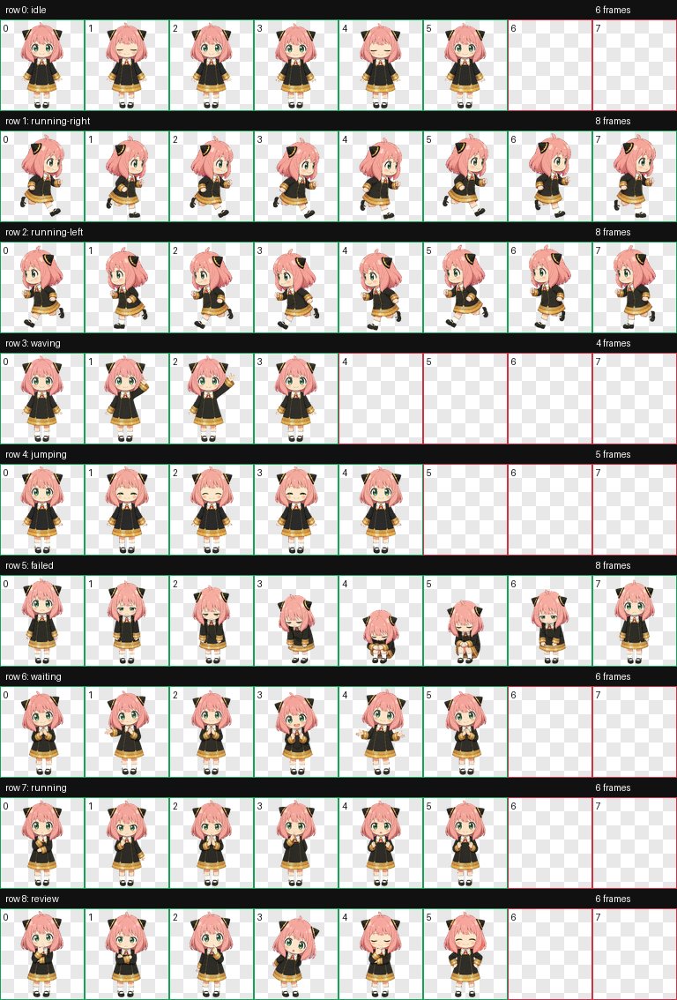

# Anya Codex Pet

An unofficial, fan-made animated Anya pet for Codex Work mode.



## Package layout

```text
anya-codex-pet/
├── v1/
│   ├── pet.json
│   └── spritesheet.webp
├── v2/
│   ├── pet.json
│   └── spritesheet.webp
├── preview/
│   ├── contact-sheet-v1.png
│   └── contact-sheet-v2.png
└── qa/
    ├── v1-validation.json
    └── v2-validation.json
```

Both `v1/` and `v2/` are complete standalone pet packages with the standard `pet.json` and `spritesheet.webp` structure.

## Version differences

| Version | Sprite sheet size | Contents | Recommended use |
| --- | ---: | --- | --- |
| v1 | `1536 × 1872` | 9 standard animation rows | **Upload a pet** dialog |
| v2 | `1536 × 2288` | 9 standard rows plus 16 look directions | Local package installation |

The current **Upload a pet** dialog accepts the v1 dimensions. Selecting the v2 sprite sheet there will produce an image-size error.

## Import v1 through Codex

1. Open the pet picker in Work mode.
2. Choose **Upload a pet**.
3. Enter `Anya` as the pet name.
4. Select [`v1/spritesheet.webp`](v1/spritesheet.webp).
5. Click **Upload**.

The upload dialog only needs the sprite sheet. The included `v1/pet.json` keeps the folder usable as a standalone local package as well.

## Install a package locally

Choose either `v1` or `v2`, then copy its two package files into the Codex pet directory:

```bash
mkdir -p ~/.codex/pets/anya
cp v2/pet.json v2/spritesheet.webp ~/.codex/pets/anya/
```

Replace `v2` with `v1` in the command to install the v1 package. Reopen the pet picker after installation; restart Codex if the list does not refresh.

## Validation

Both sprite sheets have been validated against their respective atlas contracts:

- v1: 8 columns × 9 rows, `1536 × 1872`
- v2: 8 columns × 11 rows, `1536 × 2288`, `spriteVersionNumber: 2`

Validation reports are available in [`qa/`](qa/).

## Disclaimer

This is an unofficial fan-made project and is not affiliated with or endorsed by OpenAI, SPY×FAMILY, or any related rights holder. Anya Forger and related character rights belong to their respective owners. This repository does not grant a license to the underlying character or franchise. Review applicable platform rules and rights requirements before public redistribution or commercial use.

